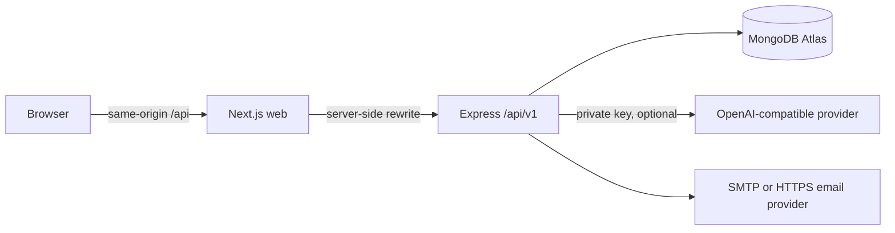

# Architecture

`apps/web` uses App Router, TypeScript, Tailwind tokens, Radix-backed dialogs/dropdowns and shadcn-style buttons, Motion, TanStack Query, Zustand, React Hook Form/Zod, TipTap, dnd-kit, Recharts, and next-themes. Feature modules live in `src/features`. Zustand persists only a workspace ID; theme storage does not contain authentication credentials.

`apps/api` separates authentication service/middleware, workspace authorization, feature resource routes, analytics, user settings, AI transport, and shared infrastructure. Mongoose schemas/models are centralized in `core/models.ts` to make cross-resource indexes and relationships visible. Related small REST handlers remain together instead of artificial one-line controller/service wrappers. Shared Zod schemas provide one input boundary for browser and server.

## REST API

Successful responses have `{ data, meta? }`. Failures have `{ error: { code, message, details? } }`. All workspace resource queries include a verified workspace ID. IDs are validated before queries. List endpoints accept bounded `page`/`limit`, search, sort and applicable status/project/priority filters; metadata returns total/page/pages. UI lists currently load up to 100 matches, so large workspaces should use search/filters; pagination UI is an extension point.

| Prefix / route                         | Operations                                                                                      |
| -------------------------------------- | ----------------------------------------------------------------------------------------------- |
| `GET /health`                          | Current database readiness (outside the versioned API)                                          |
| `/api/v1/auth`                         | csrf, register, login, refresh, logout, me, forgot/reset password, verify/resend email, contact |
| `/api/v1/users/me`                     | Profile/preferences/avatar, password, sessions, account deletion                                |
| `/api/v1/workspaces`                   | List/create workspaces, accept invitation                                                       |
| `/api/v1/workspaces/:workspaceId`      | Rename; member list; invite; member role/removal                                                |
| `…/projects`                           | Scoped CRUD; statuses include archive                                                           |
| `…/tasks`                              | Scoped CRUD; board status, due dates, subtasks and assignments                                  |
| `…/notes`                              | Sanitized rich-text CRUD; favorites, category, trash/restore                                    |
| `…/activity`                           | Recent workspace activity with actor names                                                      |
| `…/analytics`                          | Current task/project metrics, 7-day completion trends, upcoming deadlines                       |
| `…/ai/status`                          | Explicit provider availability, never credentials                                               |
| `…/ai/conversations`                   | User-private list, create, get, rename and delete                                               |
| `…/ai/conversations/:id/messages`      | POST SSE response; persistent history                                                           |
| `…/ai/conversations/:id/suggest-tasks` | Validated suggestions, not automatic mutations                                                  |
| `/api/v1/notifications`                | Scoped list and mark-all-read                                                                   |

## Data relationships

A user can belong to multiple workspaces. Workspace membership embeds roles; owner is immutable through member-role routes. Projects, tasks, notes and activities have indexed workspace references. Project members and task assignees must be workspace members. Deleting a project unlinks its tasks, preserving their content. Notes are soft-deleted before optional permanent deletion.

Sessions contain refresh-token digests, bounded previous digests for replay detection, expiry, revocation state, and minimal browser metadata. Access JWTs are checked against the session record on every authenticated request, making logout/revocation immediate. Action tokens are hashed, expiring, and atomically consumed. Database TTL indexes remove expired records, but expiry is also checked explicitly before use.

## Analytics semantics

Metrics are computed from current database records. Completing a task records `completedAt`; reopening clears it. Trends describe current completion timestamps, not a historical event-sourcing ledger. Rule-based workspace suggestions are labeled insights, not presented as generated AI. No fabricated productivity or customer metrics are added to the protected application.

## Operational boundaries

This baseline targets a single API instance. In-process rate limiters and per-conversation streaming locks are not shared across replicas; AI daily quotas are database-backed. List pages are capped at 100 matches. Avatar data is restricted to validated PNG/JPEG/WebP signatures and 250 KB, stored as a data URL for this portfolio scale. Move media to object storage for a larger deployment.

Multi-document workflows do not yet use MongoDB transactions; a mail or process failure can leave partial registration/invitation/activity steps. Recovery emails can be resent, seed is idempotent, and future hardening should add transactional/outbox patterns before a high-availability commercial launch. This limitation is documented rather than hidden behind a production certification claim.
